# ListenLoop: a 7-day loop to hear every word

[繁體中文](README.md) · **English**

> An English listening course for students in Taiwan. Built by a vibe-coding founder (Joe) as product owner, working with Claude Code, from zero to production in 21 days.
>
> This repository is a portfolio: product overview, engineering notes, and screenshots. It contains no source code.

**Live site: <https://listenloop-three.vercel.app>**

Further reading: [Case study (English)](case-study.en.md) · [個案研究（中文）](case-study.zh-Hant.md)

---

## Contents

1. [The product](#the-product)
2. [Features](#features)
3. [Screenshots](#screenshots)
4. [Architecture](#architecture)
5. [Technology choices](#technology-choices)
6. [How it was built with AI](#how-it-was-built-with-ai)
7. [Evals and quality numbers](#evals-and-quality-numbers)
8. [Cost control](#cost-control)
9. [Security and reliability](#security-and-reliability)
10. [License](#license)

---

## The product

"Listen more" is the standard advice for English listening, and most learners hit the same wall: **they get the gist but aren't sure of every word, and they practice a lot without seeing progress.**

ListenLoop turns the old-fashioned method that works (dictate every word, shadow it, test again a few days later) into a paced, seven-day course:

| Day 1: dictation                                                                                                     | Days 2–6: shadowing                                                                                              | Day 7: dictation again                                                                              |
| -------------------------------------------------------------------------------------------------------------------- | ---------------------------------------------------------------------------------------------------------------- | --------------------------------------------------------------------------------------------------- |
| Each sentence plays; the learner types it; every word is checked. Missed words are highlighted and explained (linking, weak forms). | The learner repeats each sentence; browser speech recognition shows which words were said. No recording leaves the device. | The same clip dictated again and compared sentence by sentence with Day 1, so progress becomes a number. |

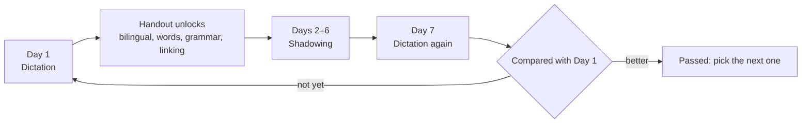

- The handout stays locked until Day 1 is done, so learners can't read the transcript first.
- Each day needs the previous one and unlocks on a new calendar day, which keeps a daily rhythm.
- Positioning: **a paced course, not a tool**, built around visible progress.
- Audience: high-school and university students in Taiwan and students abroad, plus working professionals and teachers.

## Features

- **Free official library**: daily life, travel, campus, studying abroad, work, science news, and exam-style lessons (TOEIC, TOEFL, IELTS, GEPT), plus clips from Blender's open movies. Filters for level, category, length, and accent. Only public-domain, CC BY, or CC BY-SA material, always credited.
- **Careful scoring**: case, punctuation, and contractions are normalized; every way of writing a number counts as the same (600 = six hundred, 9:30 = nine thirty, $5 = five dollars); words are aligned one by one, and extra words lower the score so guessing doesn't pay.
- **Bilingual handout**: English and Chinese side by side, key words, grammar, linking and weak forms, and hard sentences split into meaning groups. Printable as PDF.
- **My misheard words**: each missed word comes back after 1, 3, and 7 days as a short fill-in review, with no AI.
- **Learning analytics**: streaks, daily practice time, accuracy trends, and a practice calendar.
- **Create your own**: paste or upload English or Chinese text, have AI write a scenario, or upload your own recording. The system splits sentences, translates, writes notes, and generates audio (US, UK, Australian, and Indian accents). Content can be revised with a one-line instruction ("make it a horror story").
- **Public sharing**: browse others' public materials, report them; admins can take them down.
- **Classes**: teachers assign materials and see each student's Day 1 to Day 7 gain.
- **Accounts and cloud progress**: practice works signed out; signed in, progress syncs across devices, and the account and all its data can be deleted at any time.
- **Two UI languages and accessibility**: Traditional Chinese and English; dark mode, `prefers-reduced-motion`, WCAG 2.1 AA checks.
- **PWA**: installable, with offline audio caching.

## Screenshots

Taken from the live site. The result, handout, and analytics screens use sample data written into the browser, not a real learner's records.

| Home (laptop, light)                                         | Home (phone, dark)                                                     |
| ------------------------------------------------------------ | ---------------------------------------------------------------------- |
| 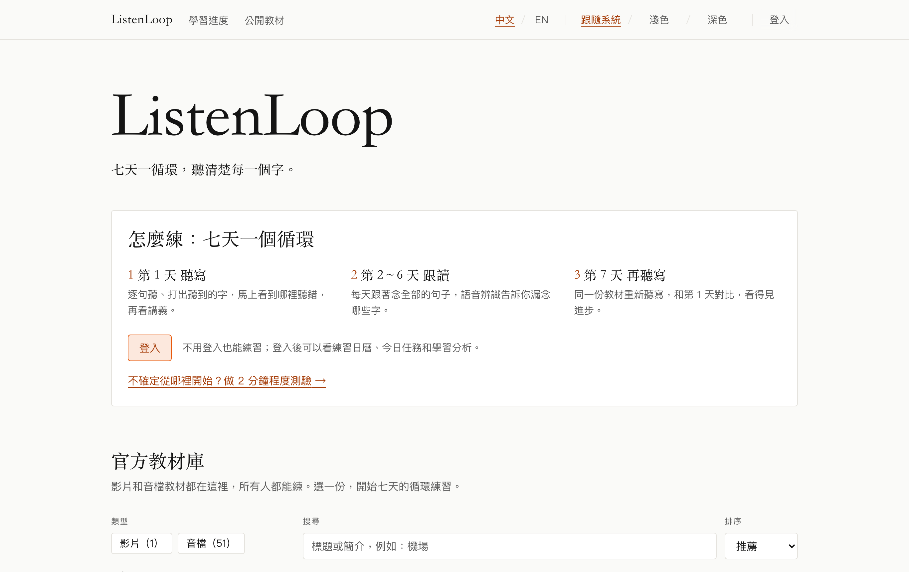 | 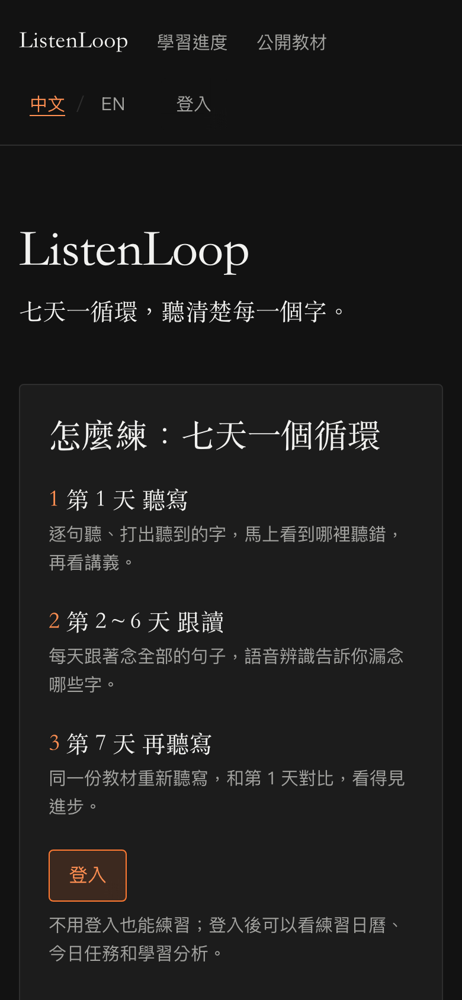 |

| Official library (laptop, dark)                                   | Official library (phone, light)                                             |
| ----------------------------------------------------------------- | --------------------------------------------------------------------------- |
| 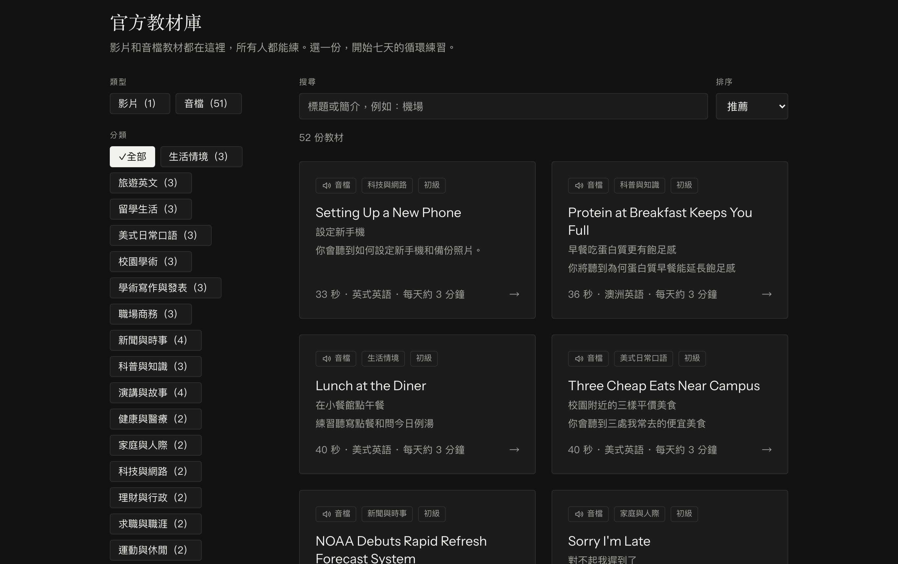  | 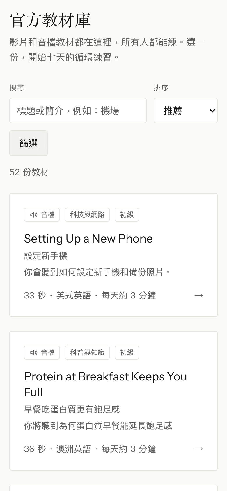 |

| Day 1 result with missed words marked (laptop, light)                        | Dictation result (phone, dark)                                                            |
| ---------------------------------------------------------------------------- | ----------------------------------------------------------------------------------------- |
| 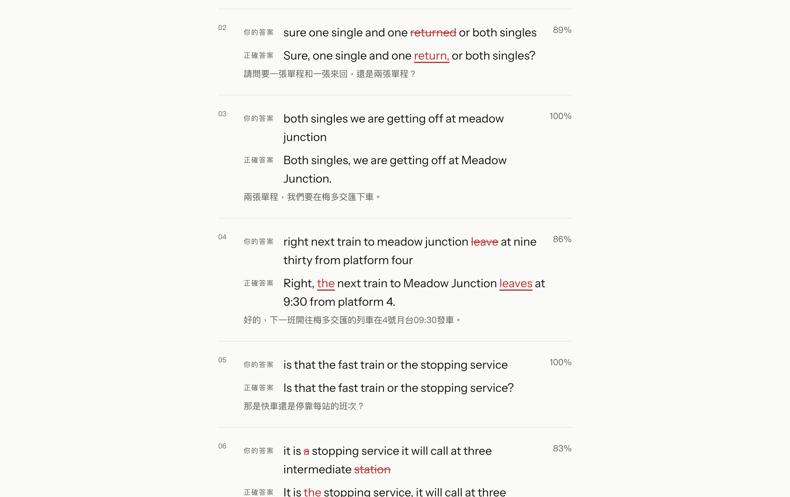 | 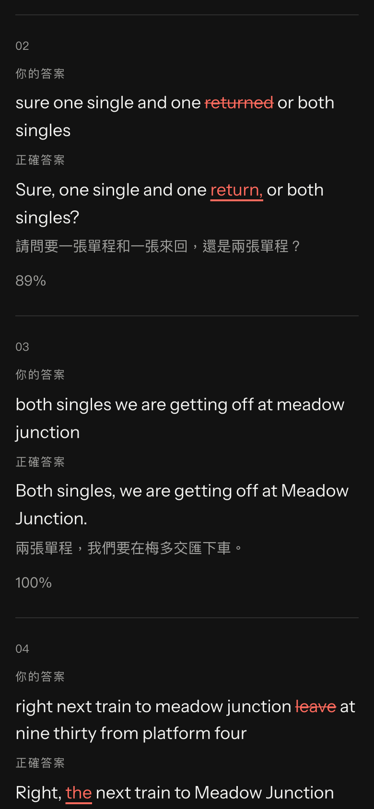 |

| Bilingual handout (laptop, dark)                                | Bilingual handout (phone, light)                                           |
| --------------------------------------------------------------- | -------------------------------------------------------------------------- |
| 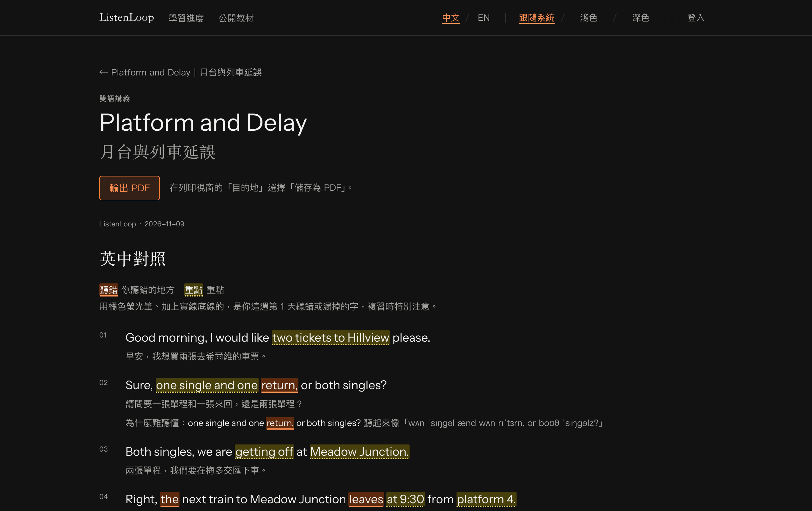 | 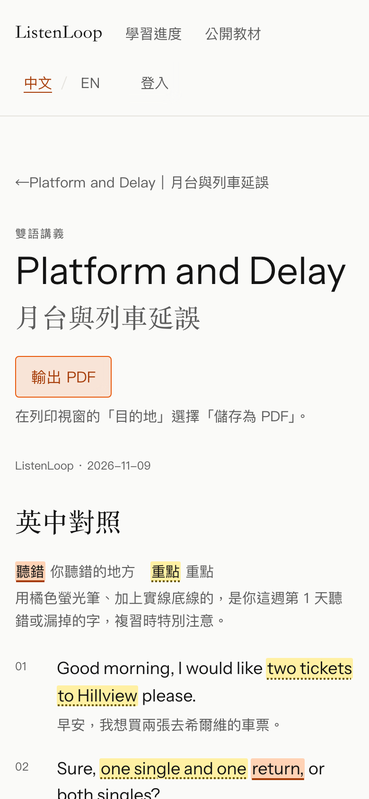 |

| Learning analytics (laptop, dark)                                   | Learning analytics (phone, light)                                             |
| ------------------------------------------------------------------- | ----------------------------------------------------------------------------- |
| 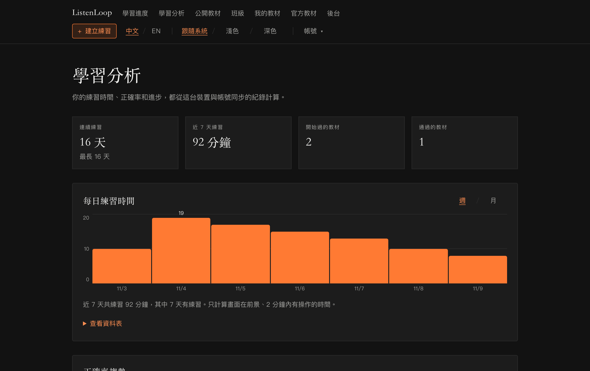 | 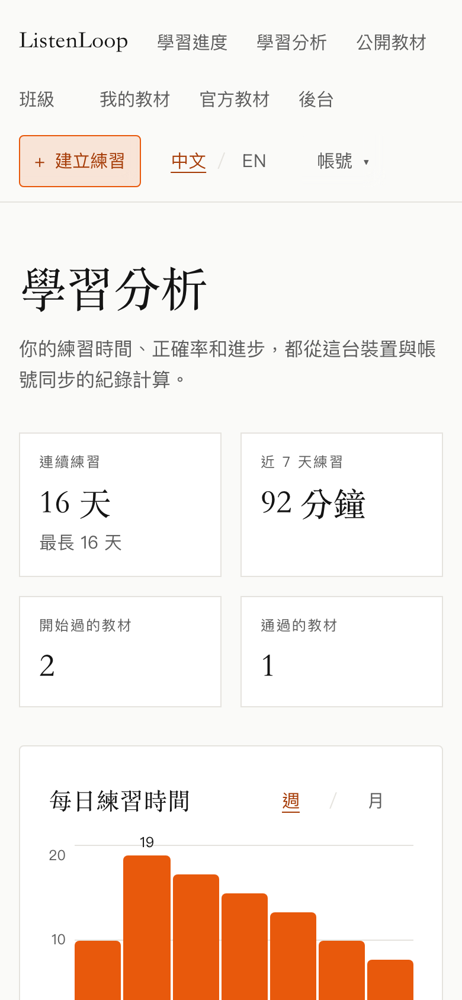 |

| Creating a material (laptop, light)                                  | Creating a material (phone, dark)                                         |
| -------------------------------------------------------------------- | ------------------------------------------------------------------------- |
| 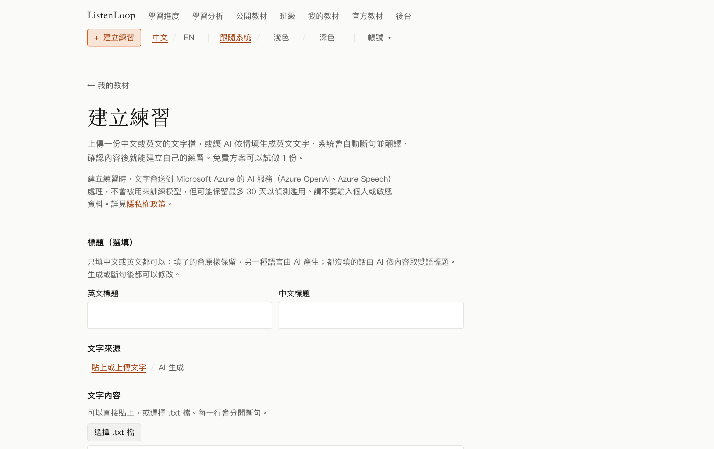      | 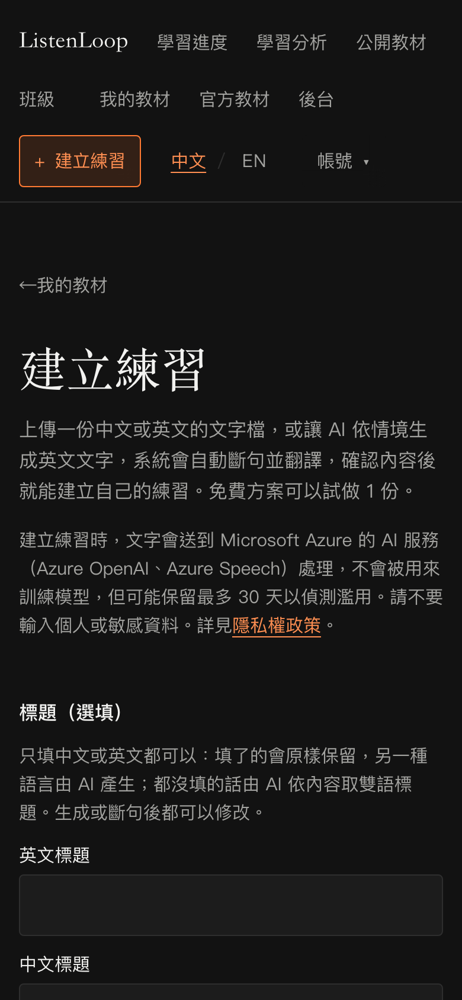 |

The interface in the screenshots is in Traditional Chinese; the site also has a full English interface.

## Architecture

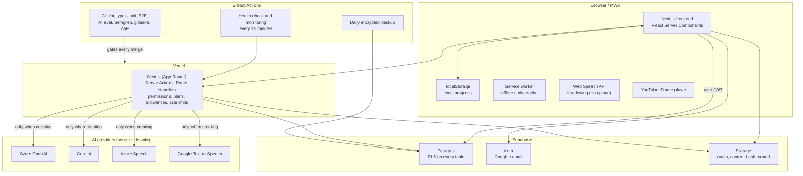

Key points:

- **AI runs only on the server, and only when a material is created.** API keys live only in the server environment, and a test checks that the client bundle contains no secrets. Practice never calls AI.
- **The browser talks to Supabase directly, protected only by row-level security**, so every table has RLS and a test enforces it.
- **Local-first progress**: written on the device first, synced to the cloud once signed in, with defined merge rules across devices.

## Technology choices

| Choice                                         | Why                                                                                                                                                                  |
| ---------------------------------------------- | -------------------------------------------------------------------------------------------------------------------------------------------------------------------- |
| **Next.js (App Router) + strict TypeScript**   | Server Actions keep permission and allowance checks on the server; Server Components ship less JavaScript to phones; strict types let the compiler catch AI-written mistakes. |
| **Tailwind CSS + a custom design system**      | Every color, spacing value, and component comes from design tokens (calm, professional, black, white, and orange); dark mode swaps tokens, not components.          |
| **next-intl**                                  | Chinese and English UI; the language lives in a cookie, no URL prefix; a test checks both message files have identical keys.                                        |
| **Supabase (Postgres, Auth, Storage)**         | One free plan covers the database, Google sign-in, and file storage; row-level security puts permissions in the database where the client can't bypass them.        |
| **Vercel**                                     | Made for Next.js: zero-config deploys and previews; the free plan fits the beta (see capacity below).                                                               |
| **YouTube IFrame Player API**                  | Plays film lessons sentence by sentence without downloading audio, within YouTube's terms (player at least 200×200, no overlays).                                    |
| **Web Speech API**                             | Shadowing recognition runs in the browser: no uploaded recordings (privacy) and no cost; unsupported browsers get an "I've said it" fallback.                       |
| **Swappable AI provider layer**                | Azure OpenAI, Gemini, Azure Speech, and Google TTS share one interface; development and tests always use fakes; switching providers doesn't touch feature code.    |
| **Vitest + Playwright**                        | Unit tests cover scoring, the 7-day rules, sync merging, plans, and allowances; E2E runs against the production build with a fixed clock.                           |
| **GitHub Actions**                             | CI, scheduled monitoring, and daily encrypted backups in one place, with no extra paid service.                                                                     |

## How it was built with AI

Joe is new to coding but holds the work to a commercial standard. Claude Code wrote all the code, tests, database migrations, and documentation; Joe owned the product direction, design acceptance, budgets, and the account setup only he could do.

**1. Judgment written down as rules.** A working-rules file tells Claude what it may decide alone and when it must stop and ask (creating accounts, anything needing a credit card, and an estimate before any real API call).

**2. Roadmap-driven, autonomous PRs.** Claude works through the roadmap in order: branch → local lint, format, typecheck, test, build, and E2E → a PR with a Traditional Chinese write-up (what changed, why it's industry practice, how to test) → squash merge on green CI → update progress, start the next item. In the morning Joe reads a progress report and a list of things to check on the live site.

**3. A decisions log.** Wherever the spec is silent, Claude picks an industry default and records the date, decision, reasoning, and where to change it. **162 decisions** so far.

**4. CI as a merge gate.** main changes only through PRs, merged only when CI is green: format, lint, types, unit tests, and E2E, plus Semgrep, gitleaks, Dependabot, and an OWASP ZAP baseline when security settings change.

**5. AI eval as a merge gate.** Any PR that touches prompts, the model, or AI post-processing must run the eval, and the new total must be ≥ main's (see below).

**6. QA sweeps (a custom skill).** Every page × 5 widths (360–1280 px) × light/dark × Chinese/English × several roles, checked automatically for overlaps, clipped text, horizontal scroll, touch-target size, axe WCAG 2.1 AA, browser errors, broken links, and slow loads. Claude fixes what's real and logs each round.

**7. AI usability tests (a custom skill).** Claude walks the main tasks as seven personas (junior-high student, high-school student, student abroad, professional, older learner, assistive-technology user, English-UI user) on phone and laptop, and fixes issues by Nielsen severity (0–4). These are **not** real-user tests; they catch obvious layout and flow problems. Real-user interviews are being planned.

**8. Escaped-bug reviews.** Every bug Joe found in production that the tests missed is logged with its cause, why the tests missed it, and the test added. Eleven so far; most came from differences between the test environment and production (time zones, phones, switching accounts, real AI output), so three time zones, two phone emulations, account switching, and the AI eval are now part of the default suite.

**Delivery metrics** (computed from merged GitHub PRs)

| Metric                          | Value                                                   |
| ------------------------------- | ------------------------------------------------------- |
| Build period                    | 2026-10-24 to 2026-11-13 (21 days)                      |
| Merged PRs                      | ~205                                                    |
| Commits per PR (average)        | 1.5; 3–7 early on, then a steady 1.0–1.5                |
| Cycle time per item (median)    | ~11 minutes                                             |
| PR opened to merged (median)    | ~4 minutes                                              |
| Database migrations             | 61                                                      |

## Evals and quality numbers

### AI eval

- **54 golden cases** in six categories: sentence splitting, translation, vocabulary/grammar/linking notes, AI-written materials, titles and summaries, and instruction-based revision.
- **100 points per case**: 60 from rule checks (e.g. half-width digits, names kept in English, notes on long sentences kept short, "going to + place" never described as "gonna") and 40 from an AI judge.
- Scores come from recorded answers, so CI re-scores without calling any API; re-recording costs about US$0.04.
- **Total score 92.06 → 96.31.** The eval caught one regression before release (a notes constraint dropped the score from 92.62 to 87.5); it was rewritten before merging.
- Every AI-content issue reported from production becomes a case tagged `regression`.

| Category                          | Cases | Score     |
| --------------------------------- | ----: | --------: |
| Sentence splitting                |     8 |    100    |
| Translation                       |    12 |    97.5   |
| Vocabulary, grammar, linking notes |   12 |    94.17  |
| AI-written materials              |     8 |    92.99  |
| Titles and summaries              |     4 |    100    |
| Instruction-based revision        |    10 |    95.67  |
| **All**                           | **54** | **96.31** |

### Tests and quality

| Item                                  | Value                                                                                                   |
| ------------------------------------- | ------------------------------------------------------------------------------------------------------- |
| Unit and component tests (Vitest)     | ~1,960                                                                                                  |
| E2E tests (Playwright)                | 159, against the production build; includes axe accessibility checks, iPhone 15 / Pixel 7 emulation, three time zones |
| QA sweep rounds                       | 58; the latest passed all 80 page/role combinations, leaving only known test-environment false alarms   |
| AI usability test                     | 11 tasks over two rounds; 0 severity 3–4 issues, all 5 severity-2 issues fixed; 0 axe violations        |
| Lighthouse (production home page)     | Mobile: performance 92, accessibility 100, best practices 100, SEO 100; desktop performance 100         |
| Load test (k6, single local process)  | 500 concurrent users: p95 37 ms, 0% errors; still 0% errors at 1,000                                    |

## Cost control

AI is the product's main variable cost, so cost control was part of the architecture from day one.

1. **Tests never spend money**: unit tests, E2E, and CI use fake providers or recorded fixtures, and real AI hosts are blocked at the network layer.
2. **Zero calls during practice**: AI runs only when a material is created; more practice costs nothing more.
3. **Content-hash caching**: the same text in the same voice is generated once; audio files are named by content hash, cached for a year, and shared across materials.
4. **A cap and a log on every call**: per-call output limits live in one place; every call records tokens, characters, and estimated cost, visible to admins.
5. **Layered daily caps** by role and kind of work, plus a site-wide monthly cap that pauses AI and sends an alert.
6. **A site-wide monthly cap of US$8**: beyond it, learners' material creation pauses.
7. **A cost circuit breaker**: every paid AI call must pass through metering, and a test scans every call site so new ones can't skip it. Alerts fire at 80% and 100% of the monthly cap.
8. **Forecasts**: the last 30 days of spend project when the AI credit runs out; daily capacity samples project when the database and storage fill up; a weekly summary is generated automatically.
9. **Plan limits in one place**: free users get 2 minutes of self-made material per week, paid users 30 materials a month; features only ask "may I?", so plan changes never touch feature code.
10. **Estimate before real API runs**: batch scripts print the worst-case cost by default and run only after explicit confirmation, checking the remaining budget before each call.

**Result**: about **US$2.08** of real AI API spend over the whole logged build, including generating the official library, a quality audit, and eval recordings.

## Security and reliability

High-level summary only.

**Security**

- A STRIDE threat model and an item-by-item OWASP Top 10 (2021) review; every gap found was fixed (e.g. recent re-authentication for high-risk admin actions, checking uploads by their real file format).
- Row-level security on every table, enforced by a test, plus a script that proves with the public key that private data is unreadable.
- A nonce-based CSP with `strict-dynamic`; HSTS, `frame-ancestors 'none'`, and the other standard security headers.
- AI input is passed to the model in a structured form; output must match a JSON schema, is validated field by field, and is always rendered as plain text.
- Automated scanning:
  - **gitleaks** over the full git history: no real secret was ever committed (every hit was a false positive such as a test placeholder).
  - **CodeQL / Semgrep**: 0 code alerts; the one Medium workflow finding (a third-party action not pinned to a commit) was fixed. After the repo went private, Semgrep open-source rules replaced CodeQL: 0 findings.
  - **OWASP ZAP baseline**: no High findings; an information-leaking header and a missing `Cross-Origin-Resource-Policy` were fixed, and each remaining item has a documented reason.
  - **npm audit** (production dependencies): 0 vulnerabilities; Dependabot checks weekly.
- A personal-data inventory with a purpose and retention period for each kind of data; deleting an account removes all related data and recordings, and a test checks that every column pointing to an account has a deletion rule.

**Reliability**

- **Kill switches**: maintenance mode, read-only mode, and per-feature switches that admins flip live; a public status page.
- **Monitoring**: a health check every 15 minutes; alerts on error rate, unusual spend, and quota or capacity thresholds.
- **Daily encrypted backups**: AES-256 before upload, kept 14 days; nothing is uploaded unencrypted.
- **Restore drill passed**: 57 migrations, row counts identical across all 50 tables, all 43 RLS policies identical, in about 3 seconds; full production recovery is estimated at about 30 minutes.
- **Capacity planning**: capacity is estimated from load tests and quotas, with a documented upgrade path and cost to 5,000 concurrent users.
- An incident runbook, deploy and migration rollback steps, and a postmortem template are in place.

## License

**All rights reserved — content and screenshots.**
The text and screenshots in this repository may not be reproduced or reused without permission. The repository contains no code, so no open-source license applies. See [LICENSE](LICENSE).

Third-party material used in lessons (such as Blender's open movies) is credited under its own license on the live site.
