# ListenLoop：七天一循環，聽清楚每一個字

**繁體中文** · [English](README.en.md)

> 給台灣學生的英文聽力課程網站。由一位 vibe coding 創辦人（Joe）擔任產品負責人，與 Claude Code 合作，21 天從零到正式上線。
>
> 這個 repo 是作品集，只有產品介紹、工程說明與截圖，不含程式碼。

**正式站：<https://listenloop-three.vercel.app>**

延伸閱讀：[個案研究（中文）](case-study.zh-Hant.md) · [Case study (English)](case-study.en.md)

---

## 目錄

1. [產品介紹](#產品介紹)
2. [功能](#功能)
3. [截圖](#截圖)
4. [架構圖](#架構圖)
5. [技術選型](#技術選型)
6. [AI 開發流程](#ai-開發流程)
7. [eval 與品質數據](#eval-與品質數據)
8. [成本控制](#成本控制)
9. [資安與可靠性](#資安與可靠性)
10. [授權](#授權)

---

## 產品介紹

「多聽」是最常見的聽力建議，但多數學習者卡在同一個地方：**聽得懂大意，卻不確定每個字；練了很多，卻看不出有沒有進步。**

ListenLoop 把老派但有效的方法（逐字聽寫、反覆跟讀、隔幾天再測）做成一份有節奏的 7 天課程：

| 第 1 天：精聽聽寫                                                                     | 第 2～6 天：跟讀                                                | 第 7 天：重新聽寫                                                     |
| ------------------------------------------------------------------------------------- | --------------------------------------------------------------- | --------------------------------------------------------------------- |
| 逐句播放、打字作答，逐字比對算正確率。錯的字用螢光筆標出，並解釋為什麼難聽（連音、弱讀）。 | 逐句播放後跟著念，瀏覽器語音辨識判斷念完、念對哪些字；錄音不上傳。 | 同一份教材完整再聽寫一次，和第 1 天逐句對比，「有沒有進步」變成一個數字。 |

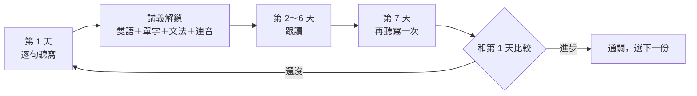

- 講義在第 1 天完成前不開放，避免先看原文。
- 每一天需完成前一天，且在不同日曆日才解鎖，形成每天固定的節奏。
- 產品定位：**不是工具，而是有節奏的課程**；重點是「看得見的進步」。
- 目標使用者：台灣的高中、大學生與留學生，也涵蓋上班族與老師、補習班。

## 功能

- **免費官方教材庫**：生活、旅遊、校園、留學、職場、科學新聞、考試風格（多益、托福、雅思、全民英檢），以及 Blender 開放電影片段；可依程度、類別、長度、口音篩選。所有素材只用公有領域或 CC BY／CC BY-SA，並標示出處。
- **精準評分**：正規化大小寫、標點與縮寫；數字的各種寫法視為相同（600 = six hundred、9:30 = nine thirty、$5 = five dollars）；逐字對齊，多寫的字也會扣分，避免亂猜矇分。
- **雙語講義**：英中對照、重點單字、文法、連音與弱讀、困難句的意群拆解，可印成 PDF。
- **我的錯字**：每個聽錯的字在 1、3、7 天後回來做短短的挖空複習，不需要 AI。
- **學習分析**：連續練習天數、每日練習時間、正確率趨勢與練習日曆。
- **自建教材**：貼上或上傳中英文文字、讓 AI 依情境生成，或上傳自己的錄音；系統自動斷句、翻譯、講解並配音（美、英、澳、印口音）。也可以用一句指令修改內容（例如「改成恐怖風」）。
- **公開分享**：瀏覽他人公開的教材，可檢舉，管理員可下架。
- **班級方案**：老師指派教材，看每位學生第 1 天到第 7 天的進步。
- **帳號與雲端進度**：不登入也能練習；登入後多台裝置同步，可以隨時刪除帳號與所有資料。
- **雙語介面與無障礙**：繁體中文、英文介面；深色模式、`prefers-reduced-motion`、WCAG 2.1 AA 檢查。
- **PWA**：可安裝到手機桌面，音檔可離線快取。

## 截圖

截圖取自正式站。結果頁、講義與學習分析使用寫入瀏覽器的範例資料，不是真實學習者的紀錄。

| 首頁（筆電，淺色）                                         | 首頁（手機，深色）                                                 |
| ---------------------------------------------------------- | ------------------------------------------------------------------ |
| 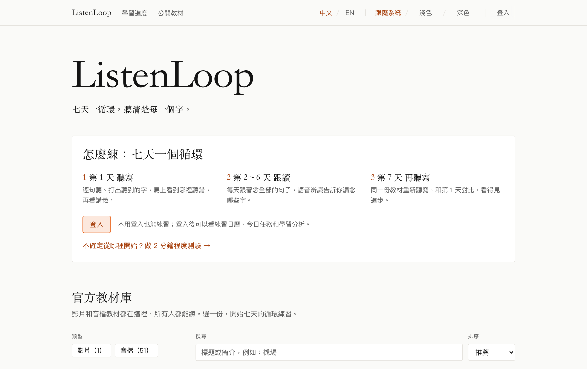    | 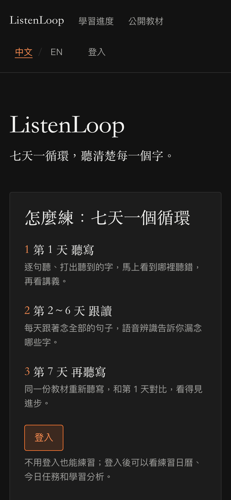 |

| 官方教材庫（筆電，深色）                                   | 官方教材庫（手機，淺色）                                           |
| ---------------------------------------------------------- | ------------------------------------------------------------------ |
| 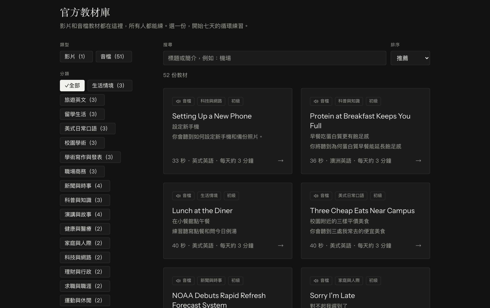 | 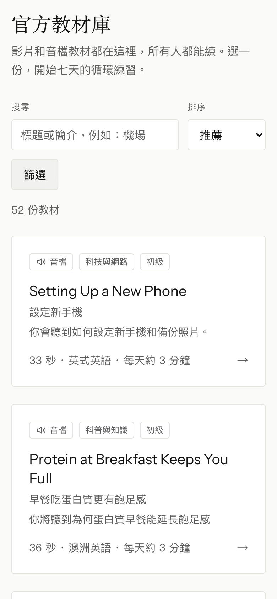 |

| 第 1 天聽寫結果：錯字標示（筆電，淺色）                                 | 聽寫結果（手機，深色）                                                       |
| ----------------------------------------------------------------------- | ---------------------------------------------------------------------------- |
| 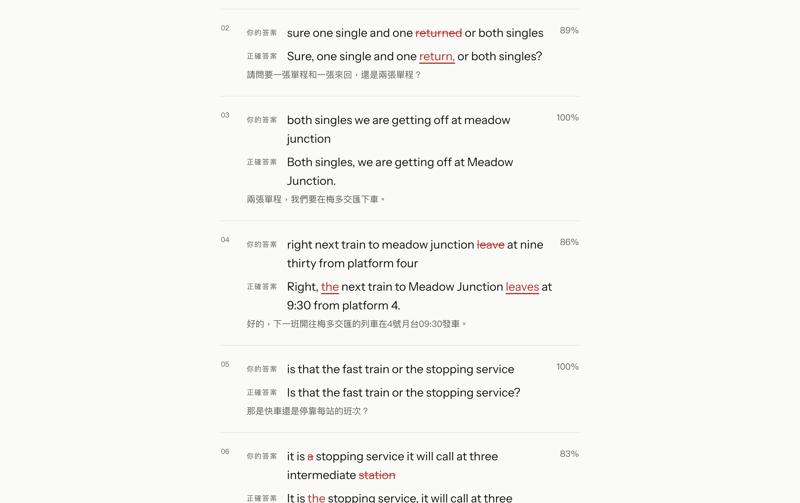 | 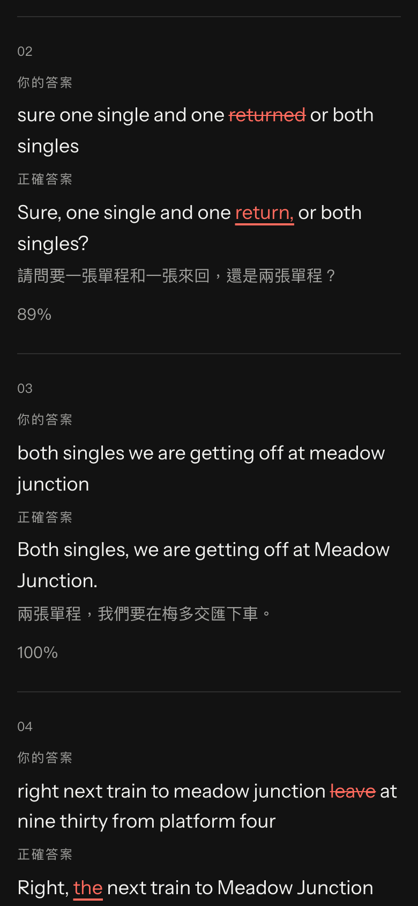 |

| 雙語講義（筆電，深色）                                    | 雙語講義（手機，淺色）                                                |
| --------------------------------------------------------- | --------------------------------------------------------------------- |
| 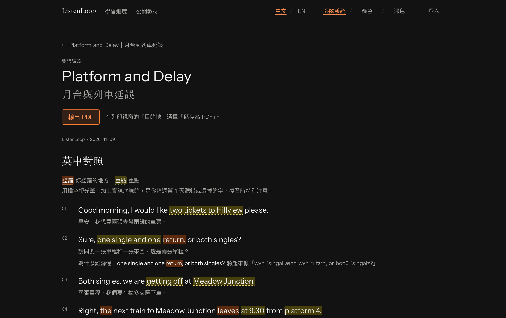 | 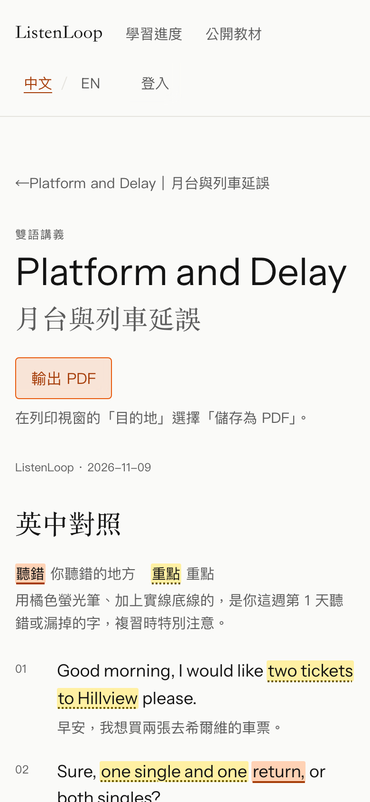 |

| 學習分析（筆電，深色）                                         | 學習分析（手機，淺色）                                                    |
| -------------------------------------------------------------- | ------------------------------------------------------------------------- |
| 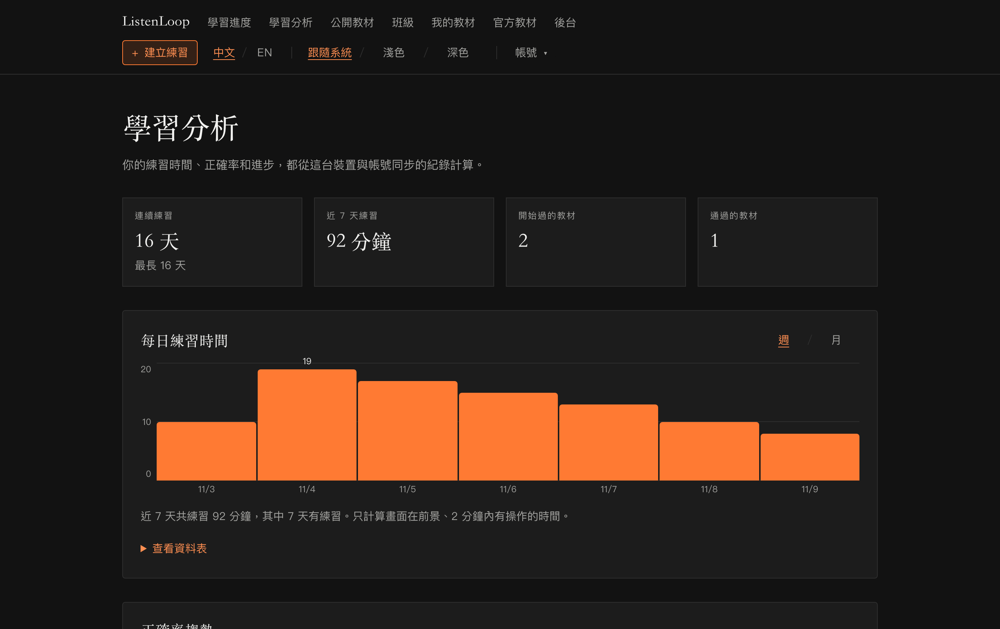 | 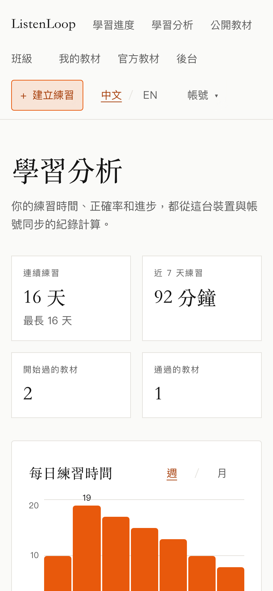 |

| 建立教材（筆電，淺色）                                       | 建立教材（手機，深色）                                                 |
| ------------------------------------------------------------ | ---------------------------------------------------------------------- |
| 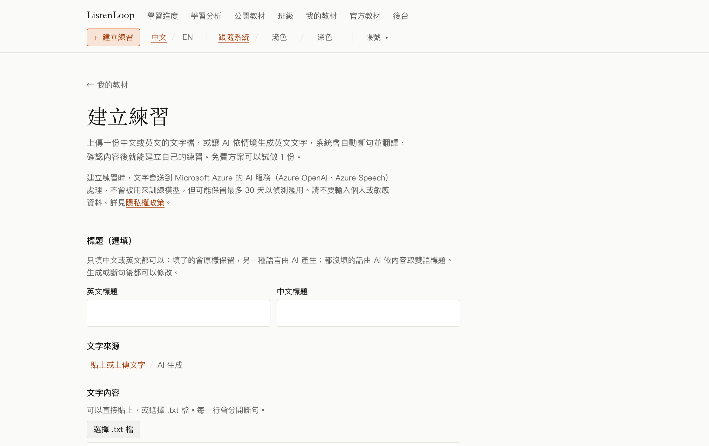 | 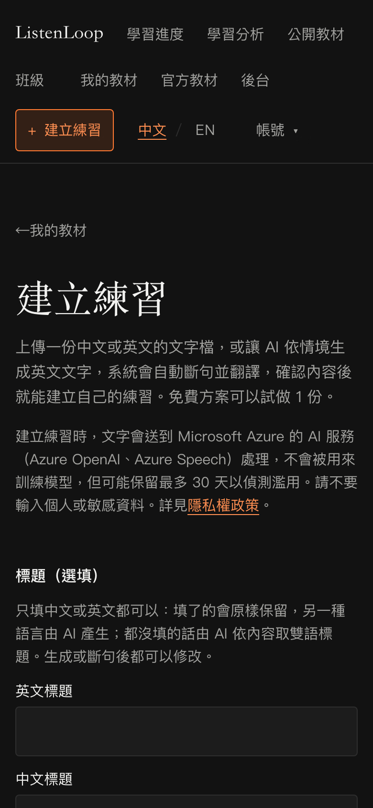 |

## 架構圖

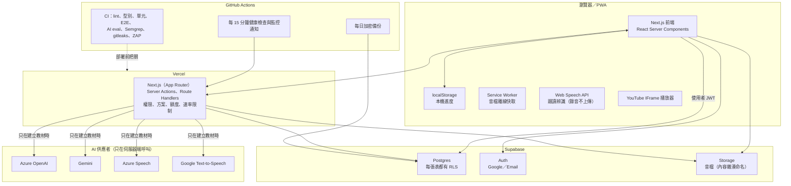

重點：

- **AI 只在伺服器端、只在建立教材時呼叫**。API 金鑰只在伺服器環境，前端 bundle 有測試確認不含任何秘密。練習時完全不呼叫 AI。
- **瀏覽器可以直接讀寫 Supabase，但只靠 RLS 保護**；所以每張表都開 RLS，並有測試強制檢查。
- **離線優先的進度**：先寫本機，登入後同步雲端；多台裝置的合併規則有明確定義。

## 技術選型

| 選擇                                    | 為什麼                                                                                                     |
| --------------------------------------- | ---------------------------------------------------------------------------------------------------------- |
| **Next.js（App Router）＋ TypeScript strict** | Server Actions 讓權限與額度檢查留在伺服器；Server Components 降低手機的 JavaScript 負擔；strict 型別讓 AI 產生的程式更容易被編譯器抓錯。 |
| **Tailwind CSS ＋自訂設計系統**          | 所有顏色、間距、元件都來自設計 tokens（沉靜、專業、黑白橘），深色模式只換 token，不改元件。                |
| **next-intl**                           | 繁中與英文介面；語言存在 cookie，不需要網址前綴；測試確認兩份翻譯檔的 key 完全一致。                       |
| **Supabase（Postgres、Auth、Storage）**  | 一個免費方案就有資料庫、Google 登入與檔案儲存；Row Level Security 把權限放在資料庫層，前端繞不過去。       |
| **Vercel**                              | 和 Next.js 同一家，部署與預覽零設定；免費方案足夠 Beta 階段（容量估算見下方）。                            |
| **YouTube IFrame Player API**           | 影片教材逐句播放，不下載音檔，遵守 YouTube 條款（播放器至少 200×200、不加遮罩）。                          |
| **Web Speech API**                      | 跟讀辨識在瀏覽器完成：不上傳錄音（隱私），也沒有成本；不支援的瀏覽器有「我念完了」備案。                   |
| **可替換的 AI 供應者層**                 | Azure OpenAI、Gemini、Azure Speech、Google TTS 實作同一介面；開發與測試一律用假的供應者，換供應者不改功能程式。 |
| **Vitest ＋ Playwright**                | 單元測試涵蓋評分、7 天循環、同步合併、方案與額度；E2E 對正式版建置執行，日期用 `page.clock` 固定。          |
| **GitHub Actions**                      | CI、排程監控、每日加密備份都在同一處，不需要額外的付費服務。                                               |

## AI 開發流程

Joe 是 vibe coding 初學者，但要求商業專案等級的品質。整個專案由 Claude Code 撰寫所有程式、測試、資料庫 migration 與文件；Joe 負責產品方向、設計驗收、預算與只有本人能做的帳號設定。

**1. 規則寫成文件，AI 才能自主**
專案的工作規則寫在給 Claude 的說明檔裡：什麼可以自己決定、什麼時候一定要停下來問（例如建立帳號、任何需要信用卡的服務、呼叫真實 API 之前要先估價）。

**2. 依路線圖自主開 PR**
Claude 依路線圖的順序一項一項做：在分支開發 → 本機跑 lint、format、typecheck、test、build 與 E2E → 開 PR（附繁體中文說明：做了什麼、為什麼是業界做法、怎麼測試）→ CI 全綠後 squash 合併 → 更新進度、做下一項。Joe 早上看「進度報告」與正式站的「測試重點」驗收。

**3. 決策紀錄**
規格沒寫到的細節，Claude 自行選擇業界預設，記下日期、決定、理由與之後要改時看哪裡。目前累積 **172 則決策**。

**4. CI 是合併門檻**
main 只透過 PR 變更，CI 全部通過才合併。改程式的 PR 會跑格式、lint、型別、單元測試、E2E；另外有 Semgrep、gitleaks、Dependabot，以及改到安全設定時的 OWASP ZAP baseline。

**5. AI eval 是合併門檻**
改到提示詞、模型或 AI 結果後處理的 PR，都要跑 eval：新版總分必須 ≥ main 才能合併（見下一節）。

**6. QA 逐頁掃描（自建 skill）**
每頁 × 5 種寬度（360～1280 px）× 淺色／深色 × 中文／英文 × 多種身分，自動檢查重疊、截斷、橫向捲動、觸控目標、axe WCAG 2.1 AA、瀏覽器錯誤、壞連結與慢載入。Claude 修正真的問題，每輪記錄。

**7. AI 模擬使用者測試（自建 skill）**
Claude 依 10 個人物誌（國中生、高中生、留學生、上班族、長輩、使用輔助科技的人、英文介面使用者、準備學測的高三生、在美國的台灣研究生、補習班老師），以訪客、免費、付費、管理員四種身分，在 iPhone、Android 模擬與筆電上走完 12 個完整流程，依 Nielsen 0～4 嚴重度修正。最近一次：3 輪、39 個流程全部完成、0 個嚴重度 3～4，模擬 SUS 73.5 → 77.5。這**不是**真人測試；真人 Beta 測試（15 人、2 週）的計畫已經準備好。

**8. 「逃脫的錯誤」檢討**
Joe 在正式站發現、但自動測試沒抓到的錯誤，都要記錄原因、為什麼測試沒抓到、補上的測試。目前記錄 11 筆，主要原因是測試環境和正式站不同（時區、手機、換帳號、真實 AI），已把三個時區、兩種手機模擬、換帳號與 AI eval 加進預設測試。

**開發效率**（從 GitHub 已合併 PR 計算）

| 指標                       | 數字                                       |
| -------------------------- | ------------------------------------------ |
| 開發期間                   | 2026-10-24 ～ 2026-11-13（21 天）           |
| 合併的 PR                  | 約 220 個                                  |
| 每個 PR 的 commit 數（平均） | 1.5；初期 3～7 次，之後穩定在 1.0～1.5 次   |
| 每項工作週期（中位數）       | 約 11 分鐘                                 |
| 開 PR 到合併（中位數）       | 約 4 分鐘                                  |
| 資料庫 migration           | 64 個                                      |

## eval 與品質數據

### AI eval

- **54 筆黃金測試集**，6 類：斷句、翻譯、單字文法與連音講解、AI 生成教材、標題與摘要、用指令修改。
- **每筆 100 分**：規則檢查 60 分（例如半形數字、人名保留英文、長句的講解不可過長、going to + 地點不能被說成 gonna）＋ AI 評分 40 分。
- 分數來自錄好的回答，CI 重算分數時不呼叫任何 API；重新錄製一次約 US$0.04。
- **總分 92.06 → 96.31**。eval 曾在上線前抓到一次退步（一版講解限制讓分數從 92.62 掉到 87.5），改寫後才合併。
- 正式站回報的 AI 內容問題，一律加成標上 `regression` 的案例，避免再犯。

| 類別                 | 案例數 | 分數      |
| -------------------- | -----: | --------: |
| 斷句                 |      8 |    100    |
| 翻譯                 |     12 |    97.5   |
| 單字、文法與連音講解 |     12 |    94.17  |
| AI 生成教材          |      8 |    92.99  |
| 標題與摘要           |      4 |    100    |
| 用指令修改           |     10 |    95.67  |
| **全部**             | **54** | **96.31** |

### 測試與品質

| 項目                     | 數字                                                                            |
| ------------------------ | ------------------------------------------------------------------------------- |
| 單元與元件測試（Vitest）  | 約 2,030 項                                                                     |
| E2E 測試（Playwright）    | 179 項，對正式版建置執行；含 axe 與鍵盤操作檢查、iPhone 15／Pixel 7 模擬、三個時區   |
| QA 逐頁掃描              | 60 輪；最新一輪 81 項組合全部通過，只剩已知的測試環境假警報                      |
| AI 模擬使用者測試         | 11 項任務兩輪；嚴重度 3～4 的問題 0 個，嚴重度 2 的 5 個全部修正；axe 違規 0     |
| Lighthouse（正式站首頁）  | 手機：效能、無障礙、最佳做法、SEO 都是 100；10 個主要頁面手機效能 96～100                   |
| 壓力測試（k6，本機單一程序） | 500 位同時使用者 p95 37 ms、錯誤率 0%；1,000 人時錯誤率仍為 0%                  |

## 成本控制

AI 是這個產品最大的變動成本，所以成本控制從第一天就是架構的一部分。

1. **測試絕不花錢**：單元測試、E2E、CI 一律使用假的供應者或已錄製的 fixture，並在網路層擋掉真實 AI 服務的網址。
2. **練習時零呼叫**：AI 只在建立教材時使用，練習次數再多也不增加成本。
3. **內容雜湊快取**：相同文字＋相同聲音只產生一次；音檔以內容雜湊命名，可以快取一年並跨教材共用。
4. **每次呼叫都有上限與紀錄**：集中設定每次呼叫的輸出上限；每次呼叫都記錄 token、字元數與估算費用，管理員在後台查看。
5. **分層每日上限**：依身分與工作類型分開，全站另有每月上限，到達時自動暫停並通知。
6. **全站每月上限 US$8**：超過時暫停一般使用者建立教材。
7. **成本斷路器**：所有付費 AI 呼叫都必須先經過計量；有測試掃描每一處呼叫，確保之後新增的也有經過。達到月上限 80% 與 100% 時會通知。
8. **預測**：依最近 30 天的平均花費推算 AI 額度何時用完；依每日容量取樣推算資料庫與儲存空間何時滿；每週自動產生摘要。
9. **方案限制集中設定**：免費每週 2 分鐘自建教材、付費每月 30 份；程式只問「能不能做」，改方案不改功能程式。
10. **真實 API 先估價**：批次腳本預設只印出最壞情況的費用，明確確認後才執行，並在每次呼叫前檢查剩餘預算。

**成果**：整個開發期間（有紀錄以來）的真實 AI API 花費約 **US$2.08**，包含官方教材生成、品質稽核與 eval 錄製。

## 資安與可靠性

以下只列高層次摘要。

**資安**

- 以 STRIDE 做威脅模型，並逐項檢查 OWASP Top 10（2021），發現的缺口都已修正（例如管理員高風險操作需要近期重新登入、上傳檔改為檢查真實格式）。
- 所有資料表開啟 RLS，有測試強制檢查；另有腳本用公開金鑰實測私密資料讀不到。
- CSP 使用 nonce 加 `strict-dynamic`；HSTS、`frame-ancestors 'none'` 等安全標頭齊全。
- AI 輸入以結構化方式傳給模型，輸出強制 JSON schema 並逐欄驗證，一律以純文字顯示。
- 自動掃描：
  - **gitleaks** 掃完整 git 歷史：沒有任何真正的金鑰曾被提交（找到的都是測試用假值等誤報）。
  - **CodeQL／Semgrep**：程式碼 0 個警告；workflow 的 1 個 Medium（第三方 action 未釘選 commit）已修正。repo 改私人後改用 Semgrep 開源規則，0 筆。
  - **OWASP ZAP baseline**：沒有 High；修正了資訊洩漏標頭與缺少的 `Cross-Origin-Resource-Policy`，其餘項目逐一說明接受理由。
  - **npm audit**（正式依賴）：0 個漏洞；Dependabot 每週檢查。
- 個資盤點與保留期限：每類資料都有用途與保留期限；刪除帳號時，所有關聯資料與錄音一併刪除，並有測試檢查每個關聯欄位都有刪除規則。

**可靠性**

- **緊急開關**：維護模式、唯讀模式與多個功能開關，管理員在後台即時切換；公開的服務狀態頁。
- **監控**：每 15 分鐘健康檢查；錯誤率、花費異常、額度與容量達門檻時通知。
- **每日加密備份**：AES-256 加密後才上傳，保留 14 天；沒有加密就不會上傳。
- **還原演練通過**：57 個 migration、50 張表筆數全部一致、43 條 RLS 規則一致，全程約 3 秒；估計正式環境約 30 分鐘可恢復服務。
- **容量規劃**：依實測與額度估算容量，並寫好擴充到 5,000 位同時使用者的升級路徑與成本。
- 事故手冊、部署與 migration 回滾步驟、事後檢討範本都已準備。

## 授權

**All rights reserved — content and screenshots.**
本 repo 的文字與截圖版權所有，未經許可不得重製或再利用。本 repo 不含程式碼，因此不採用任何開源授權。詳見 [LICENSE](LICENSE)。

教材中使用的第三方素材（例如 Blender 開放電影）依各自的授權標示出處，見正式站。
