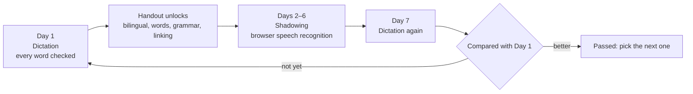

# ListenLoop case study: turning "I sort of understood it" into progress you can see

> An English listening course for students in Taiwan: one short clip, a 7-day loop, every word checked.
> Product owner Joe, new to coding, led requirements, design, and acceptance; Claude Code was the AI engineering partner. From zero to production in 21 days.
>
> Live: <https://listenloop-three.vercel.app> · [繁體中文版](case-study.zh-Hant.md) · [Back to README](README.en.md)

## Contents

1. [In one sentence](#1-in-one-sentence)
2. [The problem](#2-the-problem)
3. [Who it's for](#3-who-its-for)
4. [The solution: a 7-day loop](#4-the-solution-a-7-day-loop)
5. [Product decisions and trade-offs](#5-product-decisions-and-trade-offs)
6. [Process: AI works on its own, people hold the gates](#6-process-ai-works-on-its-own-people-hold-the-gates)
7. [Results](#7-results)
8. [My role and the AI's](#8-my-role-and-the-ais)
9. [What I learned](#9-what-i-learned)
10. [What's next](#10-whats-next)

The architecture diagram, technology choices, cost control, and security summary are in the [README](README.en.md).

---

## 1. In one sentence

ListenLoop has learners master a 1–3 minute English clip in a week: dictate it sentence by sentence on Day 1, shadow it on Days 2–6, and dictate it again on Day 7, compared word by word with Day 1, so "is my listening getting better?" finally has a number.

## 2. The problem

The standard advice for English listening in Taiwan is "listen more": shows, podcasts. Most learners then hit the same wall:

- **They get the gist but aren't sure of every word.** In an exam or a real conversation, one missed _not_ or tense changes the meaning.
- **They practice a lot but can't see progress.** "Listen more" gives no feedback, so it's hard to keep going.
- **Missed words stay missed.** Linking and weak forms (_want to_ sounding like _wanna_) hide the same kinds of words again and again, and nobody says which ones.

The method that works is old-fashioned: take a short clip, write down every word, repeat it, and test again a few days later. It's also tedious: finding material, checking answers, keeping scores. Few people last a week. ListenLoop makes that "boring but effective" routine easy.

## 3. Who it's for

| Learner                             | Situation                                 | Cares most about                            |
| ----------------------------------- | ----------------------------------------- | ------------------------------------------- |
| High school and university students | GSAT, TOEIC, TOEFL, IELTS                 | Free, scores that go up                     |
| Students abroad (or about to be)    | Classes, renting, doctors, part-time jobs | Real situations; US, UK, Australian accents |
| Working professionals               | Meetings, calls, clients                  | Done in 10 minutes a day                    |
| Teachers and cram schools           | Assigning materials, tracking students    | Class tools, each student's gain            |

Seven personas (a junior-high student, a high-school student, a student abroad, a professional, an older learner, an assistive-technology user, an English-interface user) drive an AI usability test whose findings are fixed by Nielsen severity.

## 4. The solution: a 7-day loop

- **Day 1 dictation**: each sentence plays, the learner types, and every word is compared (numbers, contractions, and percentages normalized). Missed words get a highlighter, with the sentence's notes: key words, why it's hard to hear (linking, weak forms), and a hard sentence broken into meaning groups.
- **Days 2–6 shadowing**: the browser's speech recognition shows which words were said; no recording leaves the device.
- **Day 7**: the same clip dictated again, side by side with Day 1. By default, beating Day 1 passes the week; otherwise the learner repeats it.
- **Retries don't inflate scores**: finished days can be practiced again, but the official score is the first attempt, so Day 7 can't be redone until it passes.
- **My misheard words**: each missed word comes back 1, 3, and 7 days later as a short fill-in review, with no AI.

Materials come from the free official library (including Creative Commons films such as Blender's open movies) and from learners themselves (pasted text, an AI-written scenario, or their own recording).

## 5. Product decisions and trade-offs

Every detail the spec left open has a decision record (162 so far): date, decision, reasoning, and where to change it. A few that shaped the product:

| Decision            | Chosen                                                    | Given up, and why                                                                                                         |
| ------------------- | --------------------------------------------------------- | ------------------------------------------------------------------------------------------------------------------------- |
| Motivation          | **Visible progress** (Day 1 vs Day 7, learning analytics) | A full aquarium game was built, then switched off: the product is a paced course, not a game. The code stays behind a flag. |
| Video playback      | YouTube's embedded player, sentence by sentence           | No downloading audio: YouTube's terms (at least 200×200, no overlays, no undocumented APIs).                              |
| Content licenses    | Public domain, CC BY, CC BY-SA only; no wire services     | One source's old transcripts didn't match its videos, so the whole set was paused rather than shipped.                    |
| Speech recognition  | The browser's (Web Speech API)                            | No uploaded recordings: privacy and cost. Trade-off: Chrome works best; other browsers get an "I've said it" fallback.    |
| Where AI runs       | **Only when a material is created**                       | Never during practice: costs stay predictable; each sentence's translation, notes, and audio are made once and shared.    |
| Plan limits         | One central permission file                               | Features only ask "may I?"; changing a plan never touches feature code.                                                   |
| Payments            | A fake door first                                         | Measures pricing page → plan → subscribe before wiring real payments.                                                     |
| New plans           | The student plan also starts as a fake door               | The aquarium took 6 PRs before it was switched off; big features now validate demand first.                               |
| Shared materials    | Preview the first 3 sentences; full practice is paid      | Enforced by row-level security and the server, not just hidden in the UI.                                                 |
| AI content fixes    | AI and rules only suggest                                 | Published content changes only when an admin accepts, with an audit trail.                                                |

## 6. Process: AI works on its own, people hold the gates

**Working rules in writing.** The instructions for Claude spell it out: where the spec is silent, choose an industry default, record it, and keep going; stop only for creating accounts, obtaining credentials, or anything that needs a credit card; estimate and get Joe's approval before any real API call.

**Roadmap-driven autonomous PRs.** Claude works through the roadmap item by item: branch → five local checks plus E2E → a PR with a Traditional Chinese write-up (what changed, why it's industry practice, how to test) → squash merge on green CI → update progress, start the next item. Joe reads a progress report in the morning and checks the live site against a test list.

**Layered automatic gates:**

| Layer              | What                                                                                                                   |
| ------------------ | ---------------------------------------------------------------------------------------------------------------------- |
| Unit and component | ~1,960 tests: scoring normalization and alignment, the 7-day rules, sync merging, plans and allowances, RLS coverage   |
| End to end         | 159 tests against the production build, with a stand-in Supabase, a fixed clock, three time zones, two phone emulations |
| AI eval            | 54 golden cases, 60 points from rules + 40 from an AI judge; a PR can't merge if it scores below main                   |
| Page sweep         | Every page at 5 widths × light/dark × Chinese/English × several roles: overlaps, clipping, overflow, touch targets, axe WCAG 2.1 AA; 58 rounds |
| Simulated users    | 7 personas complete the main tasks on phone and laptop; fixes by severity                                               |
| Security scanning  | Semgrep (formerly CodeQL), gitleaks, Dependabot, OWASP ZAP baseline                                                                        |

**Every escaped bug becomes a test.** Each bug found in production that the tests missed gets a review: cause, why the tests missed it, and the test added. Of 11 entries, 7 came from differences between the test environment and production (time zones, phones, switching accounts, real AI output), 3 from testing only the happy path or one role, and 3 from unscored AI content quality (an entry can fall in more than one). The responses: add those environment differences to the default suite, cover four roles in E2E, and make the AI eval a merge gate.

**Every batch gets a retrospective.** Examples: run one QA sweep or E2E suite at a time (they share a port, and running both produced false findings); treat a flaky test as a real bug first (one "flaky" test turned out to be a sync race condition); run any new automated check over the full history before adding it to CI.

## 7. Results

(As of 2026-11-13)

| Item                          | Number                                                                                          |
| ----------------------------- | ----------------------------------------------------------------------------------------------- |
| Build period                  | 2026-10-24 to 2026-11-13 (21 days)                                                              |
| Merged PRs                    | ~205; 1.5 commits per PR on average, median cycle time ~11 minutes                              |
| Unit and component tests      | ~1,960                                                                                          |
| E2E tests                     | 159                                                                                             |
| Page-sweep rounds             | 58                                                                                              |
| AI eval                       | 54 cases, total score 92.06 → 96.31                                                             |
| Recorded decisions            | 162                                                                                             |
| Database migrations           | 61                                                                                              |
| Lighthouse (home, production) | Mobile: performance 92, accessibility 100, best practices 100, SEO 100; desktop performance 100 |
| Total real AI API spend       | ~US$2.08 (since logging began; includes the official library, a quality audit, eval recordings) |
| Official materials            | 51 published audio lessons, plus Blender open-movie clips                                       |
| Restore drill                 | Row counts in all 50 tables and all 43 RLS policies matched; ~30 minutes estimated to recover   |
| Languages                     | Traditional Chinese and English UI                                                              |

## 8. My role and the AI's

I'm the **product owner**, new to coding, holding the work to a commercial standard.

**What I did:**

- **Requirements**: the product direction (a 7-day loop, "hear every word", students in Taiwan), each night's task list and priorities.
- **Design**: the design system's character (calm, professional, black, white, and orange) and UI acceptance (voice menu, navigation, progress shown only when signed in).
- **Decisions**: no gamification, only Creative Commons content, which services may cost money, the budget for every real API run, plans and pricing direction.
- **Acceptance**: testing each release on the live site from its "what to check" list and asking for fixes.
- **What only I could do**: accounts and keys for the cloud services.

**What Claude Code did:**

- All code, tests, migrations, and documentation, and each PR's write-up in Traditional Chinese.
- Industry-default choices where the spec was silent, each recorded.
- Debugging on production: a setup diagnosis page, layout shifts found by Lighthouse, contrast issues found by axe, CSP host testing.
- Research: verifying content licenses, comparing payment providers (research and a fake door only).
- The quality tooling itself: the page sweep, the AI usability test, and the AI eval, each built to be re-run.

## 9. What I learned

1. **Write judgment down as rules, and the AI can work on its own.** What helped most wasn't longer prompts but stating when to stop and ask, what to decide alone, and that every decision gets recorded.
2. **Design cost control on day one.** "No AI during practice" and content-hash caching decoupled cost from usage.
3. **Tests are the safety net for AI collaboration.** When changes come fast, E2E and the page sweep beat checking by hand, and turning checks into re-runnable skills keeps them equally strict every time.
4. **Measure AI content with evals, not spot checks.** Prompt changes used to be judged on one or two examples, and problems surfaced in production. Now about US$0.04 covers 54 cases, and regressions are stopped before merge.
5. **Ask what production has that the tests don't.** Most escaped bugs came from environment differences such as time zones, phones, and account switching, not from logic errors.
6. **Cutting a feature is a product decision.** The aquarium game was complete, but it didn't fit the positioning, so it went behind a flag that keeps the decision reversible. Big features now start as fake doors.
7. **AI output needs a human checkpoint.** The audit found one name translated two ways, and a one-word line, "Emo?", translated as the music genre. The fix wasn't trusting the AI more; it was a review queue, automatic checks, and eval regression cases.
8. **Licensing and privacy are product features.** Every source, license, and change is stored with the material; recordings never leave the browser; private data is closed and tested with RLS.

## 10. What's next

- Real-user interviews and a beta, to catch the motivations and misunderstandings simulated users can't.
- Set prices from the fake-door data, then wire real payments.
- Package the PWA for Google Play.
- More film lessons from Blender's open movies, and class-plan pilots with teachers and cram schools.

---

Last updated: 2026-11-13
