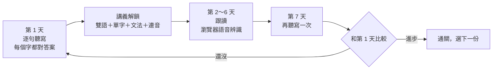

# ListenLoop 個案研究：把「聽得懂但不確定」變成看得見的進步

> 一個為台灣學生設計的英文聽力課程網站：一份教材、7 天循環、每個字都檢查。
> 產品負責人 Joe（vibe coding 初學者）主導需求、設計與驗收；Claude Code 擔任工程實作的 AI 夥伴。21 天從零到正式上線。
>
> 正式站：<https://listenloop-three.vercel.app>　·　[English version](case-study.en.md)　·　[回到 README](README.md)

## 目錄

1. [一句話總結](#1-一句話總結)
2. [問題與動機](#2-問題與動機)
3. [目標使用者](#3-目標使用者)
4. [解法：7 天循環](#4-解法7-天循環)
5. [產品決策與取捨](#5-產品決策與取捨)
6. [開發流程：讓 AI 自主、讓人把關](#6-開發流程讓-ai-自主讓人把關)
7. [成果](#7-成果)
8. [我的角色與 AI 的分工](#8-我的角色與-ai-的分工)
9. [學到的事](#9-學到的事)
10. [下一步](#10-下一步)

架構圖、技術選型、成本控制與資安摘要見 [README](README.md)。

---

## 1. 一句話總結

ListenLoop 讓學習者用一週練熟一段 1～3 分鐘的英文：第 1 天逐句聽寫、第 2～6 天跟讀、第 7 天再聽寫一次並和第 1 天逐字比較，讓「聽力有沒有進步」第一次變成一個數字。

## 2. 問題與動機

台灣學生學英文聽力，最常聽到的建議是「多聽」：看影集、聽 Podcast。但多數人遇到同一個卡關：

- **聽得懂大意，卻不確定每個字。** 考試或真實對話裡，漏掉一個否定詞、一個時態，意思就錯了。
- **練了很多，卻看不到進步。** 「多聽」沒有回饋，不知道自己是不是比上週聽得更清楚，很難持續。
- **錯過的字一直錯過。** 連音、弱讀（例如 _want to_ 聽起來像 _wanna_）讓同一類字反覆漏聽，但沒有人告訴你漏的是哪一個。

真正有效的方法很老派：拿一小段素材，逐字聽寫、反覆跟讀、過幾天再測一次。問題是這套方法很麻煩——要找素材、對答案、記錄成績，多數人撐不到一週。ListenLoop 的目標，就是把這套「無聊但有效」的流程變得容易。

## 3. 目標使用者

| 使用者           | 情境                               | 最在意                         |
| ---------------- | ---------------------------------- | ------------------------------ |
| 高中、大學生     | 準備學測、多益、托福、雅思         | 免費、能看到分數進步           |
| 留學生與準留學生 | 上課、租屋、看醫生、打工的生活英文 | 實用情境、美國／英國／澳洲口音 |
| 上班族           | 會議、電話、客戶溝通               | 每天 10 分鐘也能完成           |
| 老師與補習班     | 指派教材、追蹤學生                 | 班級管理、看到每個學生的進步   |

我們用 7 個人物誌（國中生、高中生、留學生、上班族、長輩、使用輔助科技的人、英文介面使用者）做 AI 模擬使用者測試，依 Nielsen 嚴重度修正問題。

## 4. 解法：7 天循環

- **第 1 天聽寫**：逐句播放、打字，逐字比對（數字、縮寫、百分比都會正規化）。錯的字用螢光筆標出，並顯示這句的講解：重點字、為什麼難聽（連音、弱讀）、困難句的意群拆解。
- **第 2～6 天跟讀**：瀏覽器的語音辨識判斷念完、念對哪些字；錄音不上傳。
- **第 7 天**：同一份再聽寫一次，和第 1 天逐句對比；預設「比第 1 天進步」就通關，沒通過就重新一週。
- **重練不刷分**：已完成的天數可以重練，但正式成績以第一次為準，避免第 7 天重做到通關。
- **我的錯字**：每個聽錯的字在 1、3、7 天後回來做短短的挖空複習，不需要 AI。

教材來源：免費的官方教材庫（含 Blender 開放電影等 CC 授權影片），以及使用者自建（貼上文字、AI 依情境生成，或上傳自己的錄音）。

## 5. 產品決策與取捨

每個規格沒寫到的細節都有決策紀錄（目前 162 則），包括日期、決定、理由，以及之後要改時看哪裡。幾個代表性的取捨：

| 決策         | 選擇                                             | 放棄的選項與理由                                                                                         |
| ------------ | ------------------------------------------------ | -------------------------------------------------------------------------------------------------------- |
| 激勵方式     | **看得見的進步**（第 1 天 vs 第 7 天、學習分析） | 魚缸遊戲化已經做完，但用功能開關關閉：產品定位是「有節奏的課程」，不是遊戲。程式保留，決定可以回頭。     |
| 影片播放     | YouTube 嵌入播放器逐句播放                       | 不下載影片聲音：遵守 YouTube 條款（播放器至少 200×200、不加遮罩、不用未公開的 API）。                    |
| 內容授權     | 只用公有領域、CC BY、CC BY-SA，排除通訊社        | 有一批素材的舊版逐字稿和影片對不上，整批暫停，而不是勉強上架。                                           |
| 語音辨識     | 瀏覽器內建（Web Speech API）                     | 不上傳錄音：隱私與成本；代價是 Chrome 最穩，其他瀏覽器有「我念完了」的備案。                             |
| AI 用在哪    | 只在**建立教材時**呼叫                           | 練習時從不呼叫 AI：成本可預測，同一句的翻譯、講解、音檔只產生一次並共用。                                |
| 方案限制     | 集中在一個權限設定                               | 功能程式只問「能不能做」，改方案不用改功能。                                                             |
| 收費         | 先做「假門測試」                                 | 記錄定價頁 → 選方案 → 按訂閱的漏斗，驗證付費意願後才接真正金流。                                         |
| 新方案驗證   | 學生方案也先用假門                               | 魚缸做了 6 個 PR 才關掉；之後的大功能先驗證需求再實作。                                                  |
| 公開教材     | 預覽前 3 句，完整練習是付費功能                  | 由資料庫權限（RLS）與伺服器把關，不只藏在畫面上。                                                        |
| AI 內容修正  | AI 與規則只產生「待審修正」                      | 已發布內容一律由管理員按「接受」才寫入，並記錄稽核。                                                     |

## 6. 開發流程：讓 AI 自主、讓人把關

**工作規則寫成文件。** 給 Claude 的說明檔寫清楚：規格沒寫到就選業界預設並記錄、不要停下來問；只有建立帳號、申請憑證、需要信用卡的服務才停下來；呼叫真實 API 之前先估價、等 Joe 同意。

**路線圖驅動的自主 PR。** Claude 依路線圖一項一項做：分支開發 → 本機五項檢查加 E2E → 開 PR（繁體中文說明：做了什麼、為什麼是業界做法、怎麼測試）→ CI 綠燈後 squash 合併 → 更新進度、做下一項。Joe 早上看進度報告，依「正式站測試重點」驗收。

**多層的自動把關：**

| 層級       | 內容                                                                                                    |
| ---------- | ------------------------------------------------------------------------------------------------------- |
| 單元與元件 | 約 1,960 項：評分正規化與對齊、7 天循環規則、同步合併、方案與額度、RLS 覆蓋                              |
| 端對端     | 159 項，對正式版建置執行；假的 Supabase、固定日期、三個時區、兩種手機模擬                                |
| AI eval    | 54 筆黃金測試集，規則 60 分＋AI 評分 40 分；新版不得低於 main 才能合併                                  |
| 逐頁掃描   | 每頁 5 種寬度 × 深淺色 × 中英文 × 多種身分：重疊、截斷、溢出、觸控目標、axe WCAG 2.1 AA；已跑 58 輪      |
| 模擬使用者 | 7 個人物誌在手機與筆電完成主要任務，依嚴重度修正                                                        |
| 資安掃描   | Semgrep（原 CodeQL）、gitleaks、Dependabot、OWASP ZAP baseline                                                        |

**從錯誤中補測試。** 每一個「正式站發現、但測試沒抓到」的錯誤都會檢討：原因、為什麼測試沒抓到、補上的測試。11 筆紀錄中，7 筆來自測試環境和正式站的差異（時區、手機、換帳號、真實 AI），3 筆是只測了順利的路徑或某一種身分，3 筆是 AI 內容品質沒有評分（同一筆可以屬於多類）。對策分別是把環境差異加進預設測試、E2E 涵蓋四種身分、AI eval 列為合併門檻。

**每一輪都回顧效率。** 例如：一次只跑一組 QA 或 E2E（共用連接埠，同時跑會產生假發現）；偶發失敗先當成真的錯誤追查（一次「不穩定的測試」最後證實是同步的競爭條件）；新的自動檢查先對整個歷史跑一次再上 CI。

## 7. 成果

（截至 2026-11-13）

| 項目                     | 數字                                                                |
| ------------------------ | ------------------------------------------------------------------- |
| 開發期間                 | 2026-10-24 ～ 2026-11-13（21 天）                                   |
| 合併的 PR                | 約 205 個；平均每個 PR 1.5 個 commit，工作週期中位數約 11 分鐘      |
| 單元與元件測試           | 約 1,960 項                                                         |
| E2E 測試                 | 159 項                                                              |
| QA 逐頁掃描              | 58 輪                                                               |
| AI eval                  | 54 筆，總分 92.06 → 96.31                                           |
| 決策紀錄                 | 162 則                                                              |
| 資料庫 migration         | 61 個                                                               |
| Lighthouse（正式站首頁） | 手機：效能 92、無障礙 100、最佳做法 100、SEO 100；桌機效能 100      |
| 真實 AI API 總花費       | 約 US$2.08（有紀錄以來，含官方教材生成、品質稽核與 eval 錄製）      |
| 官方教材                 | 51 份音檔教材已發布，另有 Blender 開放電影片段                      |
| 還原演練                 | 50 張表筆數、43 條 RLS 規則全部一致；估計約 30 分鐘可恢復服務       |
| 介面語言                 | 繁體中文、英文                                                      |

## 8. 我的角色與 AI 的分工

我是**產品負責人**，也是 vibe coding 初學者，但要求商業專案等級的品質。

**我負責的：**

- **需求**：產品方向（7 天循環、「聽清楚每個字」、目標使用者是台灣學生）、每晚的任務清單與優先順序。
- **設計**：設計系統的風格（沉靜、專業、黑白橘）、介面驗收（例如聲音選單、導覽列、進度只在登入後顯示）。
- **決策**：不走遊戲化、只用 CC 授權素材、哪些服務可以付費、每次真實 API 的預算、方案內容與定價方向。
- **驗收**：在正式站上依每次的「測試重點」實際操作，提出修正。
- **只有本人能做的事**：建立雲端服務的帳號與金鑰。

**Claude Code 負責的：**

- 所有程式碼、測試、資料庫 migration、文件，以及每個 PR 的繁體中文說明。
- 規格沒寫到的細節，依業界做法自行決定並記錄。
- 除錯與實測：正式站設定診斷、Lighthouse 找出的版面位移、axe 找出的對比問題、CSP 網域實測。
- 研究：素材授權查證、金流供應商比較（只做研究與假門測試）。
- 品質工具本身：QA 逐頁掃描、AI 模擬使用者測試、AI eval，都做成可以重跑的 skill 或指令。

## 9. 學到的事

1. **把判斷寫成規則，AI 才能自主。** 最有效的不是更長的提示，而是寫清楚「什麼時候停下來問我」「什麼可以自己決定」，並要求每個決定留下紀錄。
2. **成本控制要在第一天設計。** 「練習時不呼叫 AI」與「內容雜湊快取」兩個決定，讓成本和使用量脫鉤。
3. **測試是 AI 協作的安全網。** 改動很快的時候，E2E 與逐頁掃描比人工檢查更可靠；做成可重跑的 skill，讓同樣的檢查每次都一樣嚴格。
4. **AI 內容要用 eval 量化，而不是抽看。** 以前改提示詞只能看一兩個例子，問題要上線後才發現；現在花約 US$0.04 就能一次看 54 種情況，退步在合併前就被擋下。
5. **測試要問「正式站有、測試沒有的是什麼」。** 逃脫的錯誤大多來自時區、手機、換帳號這類環境差異，而不是邏輯錯誤。
6. **砍功能也是產品決策。** 魚缸遊戲化做得很完整，但和定位不合就關掉；保留開關讓決定可以回頭。之後的大功能改用假門先驗證需求。
7. **AI 產出一定要有人把關的流程。** 品質稽核發現同一個人名有兩種譯法、短句「Emo?」被譯成「情緒搖滾」；解法不是更相信 AI，而是「待審修正」加上自動檢查規則與 eval 回歸案例。
8. **授權與隱私是產品的一部分。** 每份素材的出處、授權、修改說明都寫進資料，錄音不上傳，私密資料用 RLS 實測關閉。

## 10. 下一步

- 真人使用者訪談與 Beta 試用，補上 AI 模擬測試抓不到的動機與誤解。
- 用假門測試的數據決定定價，再接真正的金流。
- 以 PWA 打包上架 Google Play。
- 擴充 Blender 開放電影等影片教材，並和老師、補習班合作試用班級方案。

---

最後更新：2026-11-13
